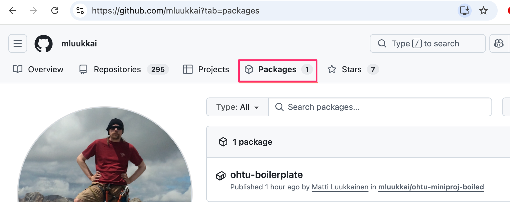
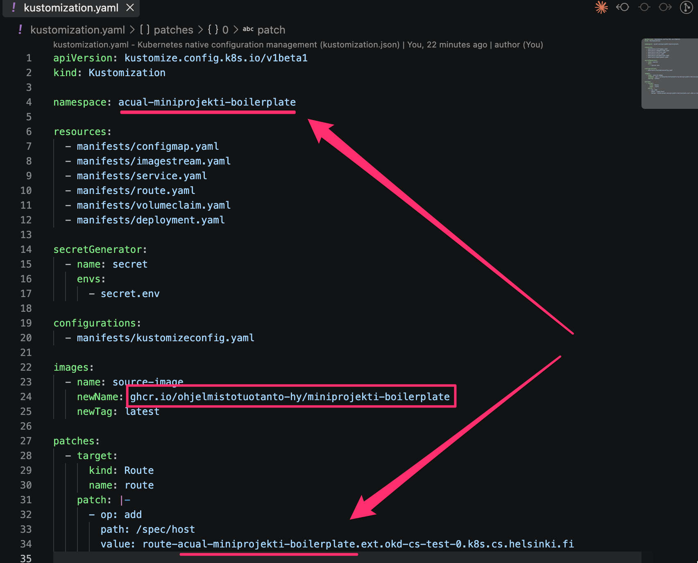

## Sovelluksen vieminen OKD-klusterille

Deployaus tarvitsee tehdä vain kerran koko ryhmän puolesta, eli riittää että yksi ryhmäläinen tekee sen. Suosittelemme kuitenkin, että asiasta on vastuussa kaksi ryhmäläistä, jotta osaaminen ei ole vain yhden henkilön varassa.

### Lähtötilanne

Oletuksena on, että

- olet jo kirjautunut `oc`-komentorivityökalulla oikeaan OKD-klusteriin ja oikeaan projektiin (`oc project <namespace>`). Ohje tähän [täällä](OKD.md).
- projekti on pushattu onnistuneesti GitHubiin ja siitä on muodostunut Docker-kuva, joka on julkinen. Varmista tämä GitHubista, repositorion Packages-välilehdeltä (Package settings → Change visibility → Public):



### Ensimmäinen deployaus

Ennen ensimmäistä klusterillevientiä eli deployausta muokkaa tiedostoon `kustomization.yaml` seuraavat kohdat omaan projektiin sopiviksi:

- `namespace` — OKD-projekti, johon sovellus deployataan. Projektin nimi löytyy kurssin palautussovelluksesta, ks. [OKD-ohje](OKD.md#4-valitse-projekti).
- `images.newName` — oman Docker-imagen osoite, johon GitHub Actions -workflow pushaa buildatun imagen. GitHub action luo repositorin nimen automaattisesti, joten osoite on muotoa `ghcr.io/<käyttäjätunnus>/<repo-nimi>`.
- `patches`-kohdan Route-patchin `value` — sovelluksen julkinen osoite. Tämän tulee olla uniikki koko klusterilla, ja muotoa `route-<projekti>.ext.okd-cs-test-0.k8s.cs.helsinki.fi`.



Ensimmäisellä kerralla luo salaisuustiedosto kopioimalla malli ja täyttämällä oikea arvo:

```sh
cp secret.env.template secret.env
```

Muokkaa tiedostoon `secret.env` oikea `SECRET_KEY`-arvo. Tiedostoa ei lisätä versionhallintaan.

Sovellus deployataan (tai päivitetään) klusterille [Kustomize](https://kustomize.io/)n avulla komennolla:

```sh
oc apply -k .
```

Komento luo/päivittää kaikki `kustomization.yaml`-tiedostossa määritellyt Kubernetes-resurssit OKD-klusterille.

Kun sovellus on käynnistynyt (tilanteen näkee komennolla `oc get pods`), luo vielä tietokannan taulut klusterille ohjeen [Tietokanta klusterilla](#tietokanta-klusterilla) mukaan.

Jos kaikki menee hyvin, käynnistyy sovellus osoitteeseen https://route-<projekti>.ext.okd-cs-test-0.k8s.cs.helsinki.fi

### Automaattinen päivittyminen

Kun sovellus on kerran deployattu, sen uudet versiot päivittyvät klusterille automaattisesti:

1. Koodi pushataan (tai pull request mergetään) main-haaraan.
2. GitHub Actionsin CI-workflow ([ci.yaml](.github/workflows/ci.yaml)) suorittaa testit.
3. Jos testit menevät läpi, workflow [docker.yaml](.github/workflows/docker.yaml) buildaa sovelluksesta Docker-kuvan ja pushaa sen osoitteeseen `ghcr.io/<käyttäjätunnus>/<repo-nimi>:latest`.
4. Klusterin ImageStream ([imagestream.yaml](manifests/imagestream.yaml)) tarkistaa ajoittain, onko kuvasta tullut uusi versio. Tarkistus tapahtuu noin vartin välein, joten päivittymisessä voi kestää hetki.
5. Kun uusi kuva löytyy, Deployment ([deployment.yaml](manifests/deployment.yaml)) käynnistää sovelluksen uudelleen uudella kuvalla.

Huomaa, että jos testit eivät mene läpi, uutta kuvaa ei buildata, eikä klusterilla oleva versio päivity. Muista myös, että kuvan tulee olla julkinen.

Jos et halua odottaa ajoittaista tarkistusta, voit pyytää klusteria hakemaan uusimman kuvan heti:

```sh
oc import-image app:latest
```

### Milloin deployaus tulee tehdä itse?

Automaattinen päivitys koskee ainoastaan sovelluksen koodia, eli Docker-kuvaa. Komento `oc apply -k .` tulee suorittaa itse, kun

- sovellus viedään klusterille ensimmäistä kertaa
- tiedostoa `kustomization.yaml` muutetaan (esim. sovelluksen osoite)
- jotain hakemiston [manifests](manifests) tiedostoista muutetaan (esim. ympäristömuuttujat tiedostossa `configmap.yaml` tai muistirajat tiedostossa `deployment.yaml`)
- tiedostoon `secret.env` tehdään muutoksia

Muutokset näihin tiedostoihin eivät siis päivity klusterille pelkällä GitHubiin pushaamisella.

Myöskään **klusterin tietokanta ei päivity automaattisesti**, ks. [Tietokanta klusterilla](#tietokanta-klusterilla).

### Tietokanta klusterilla

Sovelluksen SQLite-tietokanta sijaitsee klusterilla omalla pysyvällä levyllään ([volumeclaim.yaml](manifests/volumeclaim.yaml)). Tietokanta säilyy, kun sovellus päivittyy tai käynnistyy uudelleen, mutta automaattinen päivitys ei koske sitä: vaikka tiedostoa [src/schema.sql](src/schema.sql) muutettaisiin, klusterin tietokannan taulut pysyvät ennallaan.

Tietokanta on siis alustettava klusterilla itse

- ensimmäisen deployauksen jälkeen
- aina kun tietokannan rakennetta (eli tiedostoa `src/schema.sql`) on muutettu ja muutoksen sisältävä versio on päivittynyt klusterille

Alustus tehdään komennolla:

```sh
oc exec deploy/dep -- python src/db_helper.py
```

Komento suorittaa sovelluksen kontissa saman alustuksen, jonka teet paikallisesti komennolla `uv run python src/db_helper.py`. Se pudottaa olemassa olevat taulut ja luo ne uudelleen, eli **kaikki klusterin tietokannassa oleva data häviää**.

Suorita komento vasta, kun uusi versio on käynnissä. Tämän voi varmistaa komennolla:

```sh
oc rollout status deploy/dep
```

Jos sovellus alkaa tietokantamuutoksen jälkeen antaa klusterilla virheitä, syy on todennäköisesti se, että tietokantaa ei ole alustettu uudelleen.
