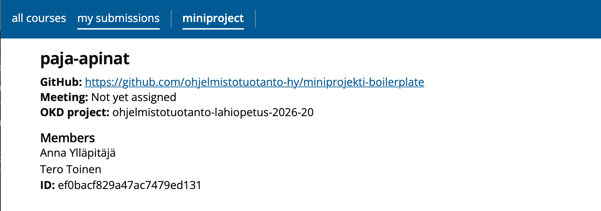

## oc ja OKD-klusteri käyttökuntoon

Lyhyt ohje `oc`-komentorivityökalun asentamiseen ja OKD-klusteriin kirjautumiseen. Laajempi ohje [täällä](https://github.com/HY-TKTL/TKT20007-Ohjelmistotuotantoprojekti/tree/master/openshift).

### 1. Asenna `oc`

Ohjeet: [Getting started with the OpenShift CLI](https://docs.okd.io/4.20/cli_reference/openshift_cli/getting-started-cli.html). Esim. macOS:llä `brew install openshift-cli`.

Tarkista asennus:

```sh
oc version
```

### 2. Ota yhteys yliopiston verkkoon

Klusteri näkyy vain yliopiston verkosta: ole Eduroamissa tai HY:n VPN:ssä.

### 3. Kirjaudu klusteriin

Avaa [OKD-webkonsoli](https://console-openshift-console.apps.okd-cs-test-0.k8s.cs.helsinki.fi), valitse oikeasta yläkulmasta oma nimesi → _Copy login command_ ja kirjaudu uudelleen. Saat komennon, joka on muotoa

```sh
oc login --token=sha256~... --server=https://api.okd-cs-test-0.k8s.cs.helsinki.fi:6443
```

Suorita komento terminaalissa. Token vanhenee ajan myötä, jolloin kirjautuminen tehdään uudelleen samalla tavalla.

### 4. Valitse projekti

Ryhmällesi on luotu valmiiksi oma projekti (namespace). Projektin nimi löytyy kurssin palautussovelluksesta, miniproject-välilehden kohdasta _OKD-projekti_. Projekti näkyy sivulla yleensä vasta miniprojektin luomista seuraavana päivänä.



Näet projektisi ja valitset sen komennoilla:

```sh
oc projects
oc project <namespace>
```

Esim. yllä olevan kuvan ryhmä valitsee projektinsa komennolla `oc project ohjelmistotuotanto-lahiopetus-2026-20`.

Varmista lopuksi, että kaikki on kunnossa:

```sh
oc status
```

Tulostuksen pitäisi olla muotoa `In project <namespace> on server https://api.okd-cs-test-0.k8s.cs.helsinki.fi:6443`.
